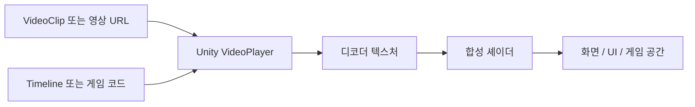

<div align="center">

# Video to Unity

### 영상으로 만드는 Unity 이펙트

[English quick start](Packages/com.victoryik.video-to-unity/Documentation~/QuickStart.en.md)

**영상을 끌어 넣고, 추천과 미리보기를 확인한 뒤, 씬에 추가하세요.**

[](Packages/com.victoryik.video-to-unity/package.json)
[](Verification/README.ko.md)
[](#설치)
[](LICENSE)

**[시작하기](Packages/com.victoryik.video-to-unity/Documentation~/Usage.ko.md) · [영상 전달 형식](Packages/com.victoryik.video-to-unity/Documentation~/VideoFormats.ko.md) · [Timeline](Packages/com.victoryik.video-to-unity/Documentation~/Timeline.ko.md) · [검증 범위](Verification/README.ko.md)**

</div>

---

Unity의 기본 영상 재생기에 합성 셰이더와 편집 도구를 연결한 플러그인입니다. 특정 게임의 씬 구조나 전환 매니저에 의존하지 않습니다.

> **네이티브 검증을 거친 프리뷰입니다.** Windows의 Unity 2022.3/6에서 Gamma·Linear 재생과 합성, Timeline, 씬 저장 검사가 통과했습니다. Unity 6의 URP·HDRP에서도 실제 Canvas·마스크 렌더링을 확인했습니다. [검사 결과와 남은 범위](Verification/README.ko.md)

## 무엇을 할 수 있나요?

| 기능 | 사용 방식 |
|---|---|
| 기존 MP4 활용 | 가산 합성, 검정 제거, 특정 색 제거를 선택합니다. |
| MP4 배경 분리 | 배경색을 자동 분석하고 보호 영역을 지정해 투명 영상을 저장합니다. |
| 실제 투명 영상 | 알파 MOV/WebM을 변환해 검정 그림과 반투명 경계를 보존합니다. |
| 화면 전환·HUD | 전체 화면이나 기존 Canvas에 배치합니다. |
| 게임 공간 이펙트 | WorldSpace Canvas로 만들어 위치·회전·크기를 조절합니다. |
| 연출 순서 | Timeline의 Video Effect Track에서 재생 시간을 제어합니다. |
| 게임 코드 연결 | Prepare / Play / Pause / Resume / Stop과 UnityEvent를 사용합니다. |
| 여러 곳에 같은 영상 표시 | Player 하나에 여러 View를 연결해 디코더를 공유합니다. |

영상은 시간에 따라 바뀌는 텍스처이므로 UI 밖에서도 사용할 수 있습니다. 월드 이펙트는 **공간에 배치하는 평면**입니다. 3D 입자나 볼륨으로 자동 변환하는 기능은 포함하지 않습니다.

## 설치

Unity **Package Manager → Add package from git URL**:

```text
https://github.com/VictoryIK12/Video-to-Unity.git?path=/Packages/com.victoryik.video-to-unity#v3.0.0-preview.5
```

공개 저장소이므로 별도의 저장소 접근 권한 없이 설치할 수 있습니다. Git이 설치되어 있지 않다면 [패키지 ZIP](dist/VideoToUnity-3.0.0-preview.5.zip)을 풀고 **Add package from disk**에서 `package.json`을 선택할 수도 있습니다. [UPM tarball](dist/com.victoryik.video-to-unity-3.0.0-preview.5.tgz)도 제공합니다.

Unity 2022.3 이상을 대상으로 하며 uGUI와 Timeline을 의존성으로 사용합니다. 기존 영상을 재생하는 데 별도 외부 프로그램은 필요하지 않습니다. **자동 분석·변환에는 FFmpeg와 ffprobe가 필요**합니다. 편집 창이 설치된 도구를 자동으로 찾아 연결합니다. 없으면 **영상 도구 자동 준비**를 사용하거나 같은 창에서 경로를 지정합니다. 자동 다운로드는 Windows x64에서 버튼을 누를 때만 실행하며, 도구는 사용자 캐시에 저장합니다. FFmpeg 실행 파일은 패키지에 포함하지 않습니다.

## 첫 이펙트 만들기

1. **Tools → Video to Unity → 영상으로 이펙트 만들기**를 엽니다.
2. 탐색기나 Project 창에서 영상 하나를 끌어 넣습니다.
3. 자동 추천과 원본·적용 결과를 확인합니다. 시간 슬라이더를 움직이면 해당 장면을 갱신합니다.
4. **화면 전체 / 선택한 UI / 게임 공간**을 고르고 **씬에 추가**를 누릅니다.
5. 씬을 저장하고 Play를 누릅니다.

영상 복사·변환, 파일 이름, 저장 위치, 이펙트 에셋 생성과 씬 배치를 같은 창에서 처리합니다. 배경이 잘못 지워졌다면 접힌 **색과 보호 영역 조절**을 열어 수정합니다. 기존 세부 설정 창은 **고급** 메뉴에 남아 있습니다. [한 창 사용법](Packages/com.victoryik.video-to-unity/Documentation~/QuickWorkflow.ko.md)

Package Manager의 **Samples → Basic video effects → Import**로 진단 영상과 코드 예제를 가져올 수 있습니다. 샘플에는 투명 영역, 불투명한 검정, 반투명 빨강, 불투명 초록과 움직이는 표식이 들어 있습니다. [샘플 설명](Packages/com.victoryik.video-to-unity/Samples~/Basic/README.md)

## 어떤 영상을 전달하면 되나요?

알파 없는 MP4도 같은 창에 넣습니다. 테두리 색이 일정하면 **단색 배경 제거**를 추천하고, 불확실하면 **원본 그대로**로 시작합니다. 자동 판별이 불확실하면 지울 색을 직접 지정합니다. 보호 사각형은 영상 전체에서 고정됩니다. [배경 분리 사용법과 한계](Packages/com.victoryik.video-to-unity/Documentation~/BackgroundRemoval.ko.md)

| 가진 영상 | 권장 방식 | 알아둘 점 |
|---|---|---|
| 검정 배경의 빛·불꽃·글로우 MP4 | **Additive** | 밝은 부분이 배경에 더해집니다. |
| 검정 배경의 일반 그래픽 MP4 | **MP4 배경 분리** 또는 BlackKey | 보호 영역으로 남길 그림을 지정할 수 있습니다. |
| 단색 배경 MP4 | **ChromaKey** | 키 색상, 문턱값, 부드러움을 조절합니다. |
| 새로 제작하는 전환·반투명 그래픽 | **ProRes 4444 MOV, RGB+Alpha, Straight** | 제작 원본으로 전달한 뒤 플러그인에서 변환합니다. |
| RGB+알파를 패킹한 MP4 | **PackedAlpha** | 왼쪽 색, 오른쪽 회색 알파 레이아웃을 사용합니다. |
| 실제 알파가 있는 WebM/VideoClip | **NativeAlpha** | Unity의 Keep Alpha와 Transcode 설정을 적용합니다. |

**MOV라는 확장자만으로 투명해지지는 않습니다.** 알파 없는 검정 영상에서는 의도한 검정 그림과 배경을 완벽하게 구별할 수 없습니다. 새 영상은 실제 알파를 포함해 전달하는 편이 결과를 예측하기 쉽습니다.

기본 변환 출력은 **RGB와 알파를 한 프레임에 담은 H.264 MP4**입니다. 하나의 디코더로 함께 재생하지만 가로 크기가 두 배가 됩니다. 1920×1080 원본은 3840×1080 영상이 되므로 대상 기기의 해상도·코덱 한도를 확인해야 합니다. Linux용 경로로 VP8 알파 WebM 변환도 제공합니다. [세부 형식과 제약](Packages/com.victoryik.video-to-unity/Documentation~/VideoFormats.ko.md)

## 코드에서 재생

```csharp
using UnityEngine;
using VideoToUnity;

public sealed class ShowEffect : MonoBehaviour
{
    public VideoEffectPlayer player;
    public VideoEffectAsset effect;

    public void WarmUp() => player.Prepare(effect);
    public void Show() => player.Play(effect);
    public void Hide() => player.Stop();
}
```

`Play`는 처음부터, `Pause`와 `Resume`은 현재 위치에서 정지·재개합니다. 반복 재생과 완료·오류 이벤트를 지원합니다. 씬을 바꾸는 시점은 게임 코드나 Timeline Signal에서 정합니다.

## 왜 이 방식인가요?



기본 경로에서 별도 RenderTexture로 매 프레임 복사하지 않고 디코더 텍스처를 직접 사용합니다. 큰 화면과 수초 길이 연출에는 이 경로가 합리적입니다. 짧고 작은 이펙트를 서로 다른 시간으로 수십 개씩 띄운다면 Flipbook·Particle System도 검토하세요. [Unity APIOnly](https://docs.unity3d.com/ja/current/ScriptReference/Video.VideoRenderMode.APIOnly.html), [Texture Sheet Animation](https://docs.unity3d.com/cn/6000.0/ScriptReference/ParticleSystem.TextureSheetAnimationModule.html)

VideoPlayer, 알파 패킹, WebM, Flipbook/VFX Graph, HAP와 AVPro를 비교한 근거는 [설계 문서](Packages/com.victoryik.video-to-unity/Documentation~/Architecture.ko.md)에 정리했습니다.

## 지원 범위

- Built-in은 Unity 2022.3/6의 Gamma·Linear에서, URP·HDRP 17.3은 Unity 6의 Linear에서 네이티브 검사했습니다. 검증 환경은 Windows·Direct3D11이며 다른 기기와 설정까지 보장하지 않습니다.
- Web은 VideoClip 대신 StreamingAssets 또는 URL을 사용합니다. 브라우저의 자동 재생·CORS·코덱 조건이 적용됩니다.
- Timeline 탐색은 비동기입니다. 즉시 정확한 프레임 표시, 역재생, 한 디코더에서 두 영상의 크로스페이드는 보장하지 않습니다.
- 변환기는 짝수 크기, 정사각형 픽셀, SDR 소스를 대상으로 합니다. 회전 메타데이터·HDR·홀수 크기 등은 이유를 표시하고 거부합니다.
- 전체 프레임 비교에는 임시 공간이 필요합니다. 예를 들어 1080p·60fps·6.6초의 원본 비교 데이터는 약 3.3GB이며 출력 파일 공간은 별도입니다.

[현재 검증 결과와 재현 방법](Verification/README.ko.md)을 확인하세요.

샘플 영상은 색상 패치와 도형으로 만든 진단용 자료입니다. 생성 스크립트와 검사 결과를 함께 제공합니다.

## 라이선스

[MIT 라이선스](LICENSE)로 개인·상업용 프로젝트에서 사용, 수정, 배포할 수 있습니다. 저작권 및 라이선스 표시를 유지하세요. Unity와 별도로 사용하는 FFmpeg 등은 각각의 사용 조건을 따릅니다. [외부 도구 안내](Packages/com.victoryik.video-to-unity/Third%20Party%20Notices.md).
